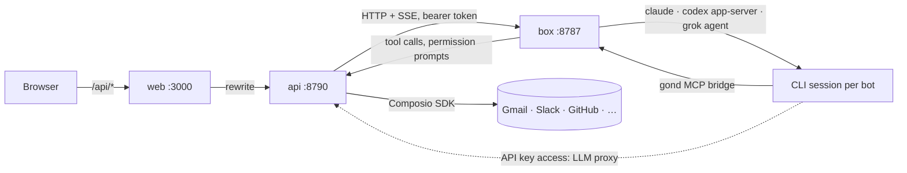

# Gond

A team of always-on AI bots, each with its own computer. Self-hosted, open
source, and it runs on the AI plans you already pay for.

Each bot has a name, a job, a personality (`SOUL.md`), a memory, and a home
folder on a shared Linux box. Under the hood it's a long-running Claude
Code, Codex or Grok session, so it keeps working after you close your
laptop. You message it like a coworker and it checks in when it needs you.

Gond is an independent remake of the idea behind Grok Bot. It isn't
affiliated with xAI, Meta or Anthropic.

## Features

- **Chat with your bots.** One conversation per bot, group rooms, @mentions,
  files, and streaming replies with a live line of what the bot is doing.
- **Bots work together.** They run in parallel, message each other and hand
  work off. Your first bot is your primary one: it answers in rooms when
  nobody is named and hears first when a teammate's run breaks; transfer it
  from the bot's settings.
- **Every bot gets a computer.** A Linux box with a shell, a browser and a
  full desktop you can open in the app to take over for a sign-in or a
  CAPTCHA. Bots use the screen the standard way: they send structured
  actions (click here, type this, press Enter), Gond's drivers run them in
  a browser that stays open between replies or on the desktop, and the
  bot sees a fresh screenshot. Files and photos you send land in the bot's
  folder, and the model sees a picture at a size it can read.
- **Approvals.** Per bot: *Always ask* (shell commands, files outside its
  own folder and app actions wait for you as a card in the chat), *Auto*
  (the default: it asks before what it can't undo or that leaves the
  computer, and a short hard list always asks) or *Always allow*.
- **Your AI, your plan.** Claude Code, Codex or Grok on your own
  subscription, signed in from Settings without a terminal. Or skip the CLI
  and use an API key (Anthropic, OpenAI, xAI or anything compatible), and
  Gond drives the model itself.
- **Connected apps.** Anything Composio supports: Gmail, Slack, GitHub,
  Notion, Linear and hundreds more. You choose which bots can use each one.
- **MCP servers.** Add your own, OAuth sign-in included.
- **Routines.** Ask a bot to do something on a schedule, like "every weekday
  at 8:00". You see each one and switch it on or off; the bot changes it.
- **Skills.** A shared library of how-tos. Type `/` to hand one to a bot, or
  let a bot save one it just figured out.
- **Secrets the bots never see.** A bot asks with a card, you type the value,
  and the API fills it in where it's needed. Anything a bot writes is
  scrubbed of stored values.
- **Memory.** Each bot has its own, plus a team memory shared by all your
  bots. Handoffs that stall get chased.
- **Notifications.** Push when a bot finishes or needs you, but not for the
  chat you're already looking at.
- **Multiple people.** Add an OIDC provider (Pocket ID, Authentik, Keycloak,
  …) and everyone gets their own bots, AI, apps, secrets and Linux account.
- **Phone and desktop.** The web app is built phone-first and can go on your
  home screen. There's also an Android app and a Rust/Tauri app for Windows
  and Linux on the releases page.

## Quick start

```sh
git clone https://github.com/dawsja/gond.git && cd gond
cp .env.example .env    # optional: your address, and a secret key on a server
docker compose up -d
docker compose logs api | grep "setup token"
```

Open http://localhost:3000, register with the setup token, and follow the
setup: pick your apps, your first bots, and what they run on. Then say hi.

You'll need Docker and, for each person, a Claude, ChatGPT or Grok plan or an
API key. Composio is optional; without it bots still have the shell and the
browser.

To build the images yourself, uncomment the `build` lines in
`docker-compose.yml` and run `docker compose up -d --build`.

## How it works

Three containers:

| Service | What it does |
|---|---|
| `web` | Next.js app. Forwards `/api/*` to the API, so there's one origin and one login. |
| `api` | Hono on Bun with SQLite. Bots, chats, approvals, routines, apps, and the client that drives the box. |
| `box` | The bots' computer: Node, Bun, Python, a browser and an Xfce desktop. No published ports. |



Each bot keeps a persistent CLI session on the box. When the CLI wants to run
something, the request travels over the `gond` MCP bridge to the API, which
turns it into an approval card. API keys never reach the box: requests go
through the API's LLM proxy, which adds the key on the way out.

## Running it

**The box keeps its state.** Homes, package caches and CLI sign-ins live on
volumes, so they survive restarts and updates.

**Update and Reset** are in Settings → Team (admin only). Update pulls the
newest box image and patches Debian and Bun in place. Reset puts
the computer back to how it was built: every person's account and home goes,
the admin's home is emptied, and the container is rebuilt from its image.
Only the CLI sign-ins are kept, so nobody signs in to their plan again; an
account, a bot's home and its SOUL.md are made again the next time they are
used, and the skills library is written back from the database. Pulling
images uses the Docker socket mounted on the API, which finds the socket's
group by itself as it starts. Remove the mount if you'd rather not give the
API that; Update then patches in place and skips the image.

**More people.** The admin is the one local account, made with the setup
token, and can always sign in with a password. To let others in, add your
identity provider in Settings → Authentication. Register a client with the
redirect URL `<APP_URL>/api/auth/callback/oidc` and the sign-out URL
`<APP_URL>/login`. Everyone who signs in that way gets their own Linux
account (`gond-<name>`) with a private home, and nothing is shared between
people except the skills library.

**MCP servers that need a sign-in.** Gond discovers the authorization server,
registers itself as a client and shows a Sign in button. If a server doesn't
allow client registration, set `GOND_MCP_CLIENT_ID` (and
`GOND_MCP_CLIENT_SECRET`) to a client you registered yourself, with
`<APP_URL>/api/mcp-servers/oauth/callback` as its redirect URL.

**Remote access.** The web app speaks plain HTTP. Put a TLS reverse proxy in
front of `web`, set `APP_URL` to that address, and leave the API and box
unpublished (the compose file already does). Push notifications on phones
need HTTPS.

**Building the Android app.** Java 17+, the Android SDK with platform 36
(`ANDROID_HOME` set) and Gradle 8.13+, then `gradle assembleRelease` in
`apps/android`. Without `GOND_ANDROID_KEYSTORE` and its password and alias
variables it's signed with the debug key.

**Advanced settings.** `.env.example` holds the two settings most installs
need. These also work in `.env`, and nothing needs them:

| Variable | What it does | Default |
|---|---|---|
| `GOND_PORT` | The port the web app is published on (this machine only) | `3000` |
| `GOND_SETUP_TOKEN` | The token for registering the admin | random, in the API's logs |
| `BETTER_AUTH_SECRET` | Signs sign-in sessions | derived from the secret key |
| `COMPOSIO_API_KEY` | The admin's Composio key until they add their own in Settings → Apps | none |
| `COMPOSIO_TOOLKITS` | Narrows the app list, comma-separated slugs | every app in the list |
| `GOND_MCP_CLIENT_ID`, `GOND_MCP_CLIENT_SECRET` | An OAuth client for an MCP server that won't register one | none |
| `GOND_APPROVAL_TIMEOUT_MINUTES` | How long an approval card waits | `30` |
| `GOND_NUDGE_MINUTES` | How long a handed-off task waits before a nudge | `120` |
| `GOND_TURN_TIMING` | Set to `1` to log how long each bot turn took and where the time went | off |
| `BOT_IDLE_MS` | How long an idle bot session stays open | `600000` |
| `GOND_BOX_MEMORY`, `GOND_BOX_CPUS`, `GOND_BOX_SHM` | The computer's limits | `4g`, `2`, `256m` |

## Moving from Kru Bot

Gond is Kru Bot renamed, so an install moves over with its data: the same
volumes under new names, the same `.env` under new names, and one sign-in.

1. Stop the old install: `docker compose down`.
2. Point the clone at the new repository and pull it:
   `git remote set-url origin https://github.com/dawsja/gond.git && git pull`.
3. Make the new volumes, still empty: `docker compose pull && docker compose
   create`.
4. Copy each of the seven volumes into its new one:

   ```sh
   docker run --rm -v kru-data:/from -v gond-data:/to alpine sh -c 'cd /from && cp -a . /to'
   ```

   The seven are `kru-data`, `kru-box-state`, `kru-box-homes`,
   `kru-box-home`, `kru-box-bots`, `kru-box-cache` and `kru-box-claude`,
   each to the same name with `gond` for `kru`. Compose prefixes a volume
   with the project name, the folder's by default, so the real names are
   more like `krubot_kru-data` and `gond_gond-data`; `docker volume ls`
   shows them.
5. Rename the variables in `.env`: `sed -i 's/^KRU_/GOND_/' .env`. The old
   names still work this release, with a warning in the API's logs.
6. Rename the repository secrets in CI (`KRU_ANDROID_*` → `GOND_ANDROID_*`)
   if you build the Android app there.
7. `docker compose up -d`.

The first start logs what it moved: the database file renamed, the tables
renamed, the stored secrets re-keyed under the new names, and every
person's account on the box renamed from `kru-<name>` to `gond-<name>`.
Sessions don't carry over, so everyone signs in again, once. Then open
Settings → Computer → Update so the box picks up its new image. Composio
connections are untouched: their ids are kept on purpose. Install the new
desktop and Android apps from the releases page; they have new ids, so they
sit beside the old ones until you remove those. Once everything is in and
working, `docker volume rm` the `kru-*` volumes.

## Development

Bun everywhere, never npm. Read `CLAUDE.md` first; it has the conventions.

```sh
bun install
bun run dev:api            # http://127.0.0.1:8790
bun run dev:web            # http://127.0.0.1:3000
docker compose up -d box   # set GOND_BOX_URL and GOND_BOX_TOKEN on the API
```

Before a commit:

```sh
bun run lint
bun run typecheck
bun run test
bun run --filter @gond/web build
```

CI runs the same checks, then builds the images for amd64 and arm64 and
publishes them to GHCR on `main` and on `v*` tags.

```
apps/web         Next.js app (shadcn + Tailwind 4)
apps/api         Hono API: auth, data, dispatcher, approvals, Composio, routines
apps/desktop     Rust/Tauri app for Windows and Linux
apps/android     Kotlin app: a Connect screen, then the web app
packages/box     The bots' computer: CLI sessions, MCP bridge, desktop, updater
packages/shared  Types, schemas, templates and the app catalog
```

## Security

- Registering the admin account needs the setup token from the API's logs.
- Secrets and keys are encrypted at rest with a key in the data volume
  (`GOND_SECRET_KEY` to bring your own), and never sent to the box. The
  exception is a website sign-in you give a bot on a login card: the API
  types it into the page as keystrokes, and the bot never sees it.
- App actions run through Composio in the API, so app credentials never
  reach the box either.
- Each person's bots run as that person's unprivileged Linux user. That keeps
  people apart, but it's Unix permissions inside one container, not a hard
  boundary. Separate bots of the same person aren't a boundary at all.
- The Docker socket on the API is the only thing with host access. Drop the
  mount if you don't need Update.

## License

MIT. Provider names and logos are trademarks of their owners.
